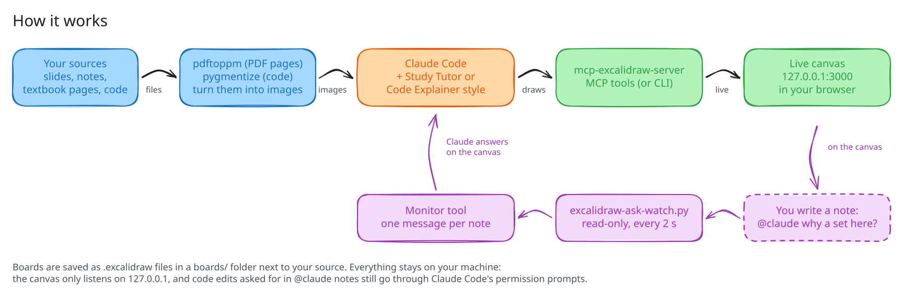

# claude-excalidraw-tutor

Two [Claude Code](https://claude.com/claude-code) **output styles** that turn Claude into a visual teacher on a live [Excalidraw](https://excalidraw.com) canvas:

| Style | What it does |
|---|---|
| **Study Tutor** (`output-styles/study-tutor.md`) | Teaches **any subject** from your own slides, notes or textbook pages. Your source sits on the left and a hand-drawn whiteboard explanation on the right, told as one connected story. It has predict-first questions with hidden answers, side-by-side comparisons, a "Your turn" problem, and a Remember box. |
| **Code Explainer** (`output-styles/code-explainer.md`) | Answers **one question about a codebase** at a time (how it works, feature path, debug, change impact) at **brief / normal / deep** depth. It puts a "photo" of the code on the left and a flow, contract, traced example and gotchas on the right. You can also ask follow-up questions or request edits by writing `@claude …` notes **on the canvas**. |

Both styles share one visual language:
- **Board style:** handwritten font, soft curved arrows, fixed spacing, and real superscripts and subscripts.
- **Colors:** blue for structure, orange for what's changing, green for done, red for the takeaway, and purple for the story thread that links each step to the next.

The teaching rules are based on learning research (worked examples, split attention, predict-first, the expertise-reversal effect). The sources are listed at the bottom of each style file.

---

## How it works

<picture>
  <source media="(prefers-color-scheme: dark)" srcset="docs/how-it-works-dark.svg">
  <source media="(prefers-color-scheme: light)" srcset="docs/how-it-works.svg">
  
</picture>

The diagram was drawn on the canvas by these tools, with a light and a dark version that GitHub picks from your theme. Its editable source is [`docs/how-it-works.excalidraw`](docs/how-it-works.excalidraw), which you can open at excalidraw.com or in the Obsidian Excalidraw plugin.

- **Drawing:** [`mcp-excalidraw-server`](https://github.com/yctimlin/mcp_excalidraw) (MIT, community project) runs a local canvas and exposes it as MCP tools *and* a CLI. The MCP tools are recommended. If they aren't loaded in the current session, the styles fall back to the CLI and tell you how to get the MCP.
- **Source images:** PDFs are rendered page by page with Poppler's `pdftoppm`. Code is rendered with Pygments into syntax-highlighted PNGs with real line numbers. Both are embedded in the canvas as image elements.
- **`@claude` notes:** `tools/excalidraw-ask-watch.py` reads `GET /api/elements` every 2 seconds. It is **read-only**. It prints one line per new note that starts with `@claude` and has text after it, once the note has stayed the same for about 6 seconds (so half-typed notes don't fire). Notes it has already handled are remembered in `~/.cache/excalidraw-ask/seen.txt`. Claude Code's Monitor tool turns each line into a message, so Claude answers on the canvas.
  - Code edits requested this way still go through Claude Code's normal permission prompts.
  - The watcher only works while a Claude Code session is open with the Code Explainer style. Each watch lasts up to 30 minutes, and the style re-arms it.

## Requirements

| Tool | Why | Required? |
|---|---|---|
| Claude Code | runs the styles | yes |
| Node.js ≥ 20 | runs `mcp-excalidraw-server` via `npx` | yes |
| Python 3 | the `@claude` watcher and Pygments | yes |
| A browser | to watch the canvas at http://127.0.0.1:3000 | yes |
| Poppler (`pdftoppm`) | renders PDF pages (Study Tutor) | for PDF sources |
| Pygments + Pillow | renders code photos (Code Explainer) | for Code Explainer |
| Source Code Pro font | the font used in code photos | recommended (Consolas or Menlo work as fallbacks) |
| Anki + AnkiConnect, and an Anki MCP server | `cards` puts cards straight into Anki | optional |
| A Manim MCP server | `animate` renders a trace as a video | optional |

---

## Setup

### Linux (tested on Fedora 43)

```bash
# Fedora
sudo dnf install nodejs python3 python3-pygments python3-pillow poppler-utils adobe-source-code-pro-fonts
# Ubuntu / Debian
sudo apt install nodejs npm python3 python3-pygments python3-pil poppler-utils fonts-source-code-pro
# Arch
sudo pacman -S nodejs npm python python-pygments python-pillow poppler adobe-source-code-pro-fonts

git clone https://github.com/TanushReddy111/claude-excalidraw-tutor.git
cd claude-excalidraw-tutor
./install.sh
```

Ubuntu's packaged Node may be older than 20. If `node --version` shows less than 20, install Node from [nodejs.org](https://nodejs.org) or with `nvm`.

### macOS (not yet tested, uses the Homebrew equivalents)

```bash
brew install node python poppler
brew install --cask font-source-code-pro
python3 -m pip install --user pygments pillow

git clone https://github.com/TanushReddy111/claude-excalidraw-tutor.git
cd claude-excalidraw-tutor
./install.sh
```

If the font isn't found, use `font_name=Menlo` in the Pygments command. Menlo is built into macOS.

### Windows (not yet tested, uses the winget/Scoop equivalents)

Native Windows (PowerShell):

```powershell
winget install OpenJS.NodeJS.LTS
winget install Python.Python.3.12
# Poppler: pick one
scoop install poppler          # or: choco install poppler
python -m pip install pygments pillow
# Font: install Source Code Pro from https://fonts.google.com/specimen/Source+Code+Pro
#       or use the built-in Consolas (font_name=Consolas)

git clone https://github.com/TanushReddy111/claude-excalidraw-tutor.git
cd claude-excalidraw-tutor
powershell -ExecutionPolicy Bypass -File .\install.ps1
```

Notes for Windows:
- **Commands:** use `python` instead of `python3`. If `pygmentize` isn't on your PATH, use `python -m pygments` instead.
- **Watcher path:** the watcher lives at `%USERPROFILE%\.claude\tools\excalidraw-ask-watch.py`.
- **WSL alternative:** you can run Claude Code inside WSL and follow the Linux steps. Open the canvas in your Windows browser at http://127.0.0.1:3000, since WSL forwards localhost by default.

### What the install scripts do

Read them before running. They're short.

1. Copy both styles to `~/.claude/output-styles/`, and the watcher to `~/.claude/tools/`.
2. Register the Excalidraw MCP server for your user, unless it's already registered: `claude mcp add excalidraw --scope user -- npx -y mcp-excalidraw-server`
3. Install the Excalidraw agent skill: `npx -y mcp-excalidraw-server install-skill`

Nothing is sent anywhere. The canvas runs on `127.0.0.1` only. Don't change `HOST` to a public address: the canvas API has no authentication.

---

## Use

1. **Restart `claude`,** so the new MCP server's tools load.
2. **Pick a style:** run `/output-style` and choose **Study Tutor** or **Code Explainer**.
3. **Open http://127.0.0.1:3000** in your browser. The canvas starts by itself the first time it's used.
4. **Run `setup`.** It checks everything and tells you the exact fix for anything that's missing.

**Study Tutor:**
```
teach me ~/notes/lecture7.pdf
```
Commands: `next`, `reveal`, `simpler`, `faster`, `trace`, `quiz`, `cards`, `animate`, `where`, `save`

**Code Explainer:**
```
brief: how does the checkout flow reach the payment API?
debug: login() returns None for valid users
deep: what breaks if I change parse_row?
```
Commands: `ask`, `debug <symptom>`, `brief` / `normal` / `deep`, `next`, `trace <input>`, `jump <fn>`, `compare <a> <b>`, `map`, `where`, `cards`, `save`. You can also write `@claude …` notes on the canvas.

Boards are saved as `.excalidraw` files in a `boards/` folder next to your source. You can open them later at excalidraw.com, or with the Obsidian Excalidraw plugin.

## Credits

- **Canvas, MCP server and CLI:** [yctimlin/mcp_excalidraw](https://github.com/yctimlin/mcp_excalidraw) (MIT)
- **Ideas taken from other open-source AI tutors:**
  - [THU-MAIC/OpenMAIC](https://github.com/THU-MAIC/OpenMAIC): plan an outline first, then scenes
  - [molly554/whiteboard-ai-tutor](https://github.com/molly554/whiteboard-ai-tutor): one idea per step, narration that matches the drawing, and drawing new content in free space
- **Excalidraw:** [excalidraw/excalidraw](https://github.com/excalidraw/excalidraw)

## License

MIT. See [LICENSE](LICENSE).
